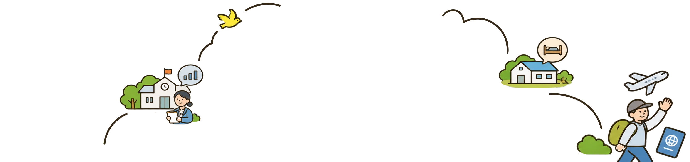

# 쥬비랜드 main-section01 (히어로) – 최종 정리

새 채팅에서 이어서 작업할 때 이 문서를 첨부하거나 붙여 넣으세요.

## 1. 현재 상태

| 항목 | 내용 |
|---|---|
| 섹션 | main-section01 "글로벌 농업 인재 경력패스" |
| 피그마 | 파일 `HHPsMjvMsTT7AzT5Qz4QQu` / main-section01(pc) 노드 `21:1289` (1600×742) / main-section01(mob) 노드 `38:1262` (1080×1080) |
| 깃허브 저장소 | `kimain1404-design/juviland` 안의 `main-section01` 폴더 |
| 배포 주소 | https://kimain1404-design.github.io/juviland/main-section01/ |
| 라이브클래스 | 에디터 HTML(`<>`) 모드에 아래 4번 iframe 코드 삽입 |
| 버튼 링크 | 지자체 상담 신청 → https://zuviland.liveklass.com/forms/cfBSdTVSrAgpXcufGgXf |
| | 문의하기 → https://zuviland.liveklass.com/forms/rZFHNFGr3zg7F7dBjXGt (둘 다 새 탭) |

참고: 예전 폴더 `juvi-hero`와 저장소 맨 위의 중복 파일(`index.html`, `style.css`, `script.js`, `README.md`)은 라이브클래스 주소를 `main-section01`로 바꾼 뒤 지우면 됩니다.

## 2. 확정된 디자인·모션 결정

- **배경**: 수채화 배경 1장(`main-section01-bg.jpg`)을 PC·모바일 공통으로 사용.
- **주변 일러스트(Group 7, `main-section01(pc)-scene.webp`)**: 고정, 모션 없음.
- **가운데 인물(`main-section01-people.webp`)**: 아래에서 올라오며 등장(0.85s 시작, 1.2s) → 2.1s부터 3초 주기로 위아래 반복. 위로 올리면 잘린 하단에 빈틈이 생겨서 시안 위치에서 **아래로만** 3% 내려갔다 돌아옴.
- **텍스트·버튼**: 배경 줌아웃(1.2s) → 제목 1·2줄 밀려 올라옴(0.15s/0.27s) → 설명(0.55s) → 버튼(0.7s/0.8s).
- **PC (1200px 이상)**: 텍스트·버튼·간격·일러스트를 1600 시안 비율로 함께 축소 → 버튼과 곡선 간격이 시안대로 유지. 1600px 이상은 원본 크기로 가운데 정렬, 왼쪽 언덕은 `main-section01(pc)-scene-edge.png`로 화면 끝까지 연장.
- **태블릿 (768~1199px)**: 글자 고정 크기, 일러스트는 버튼 아래 20px부터.
- **모바일 (767px 이하)**: 1080 시안 비율 그대로(540px에서 상한). 버튼도 시안 비율(232×78 → 390px에서 약 84×28)이고, 누르는 영역만 위아래 8px 확장. 최소 글자 크기 없음(iframe 높이 계산과 맞추기 위해).
- **줄바꿈 고정**: 제목·설명에 `white-space: nowrap` → 줄 수가 바뀌지 않아 iframe 높이가 정확히 맞음.
- **iframe 대응**: iframe 안이면 `is-embed` 클래스로 스크롤바 숨김.
- **모션 최소화 설정**: 켠 사용자에게는 모션 없이 완성 화면 표시.
- **제목 서체**: 원주체. `fonts/Wonju-Bold.woff2`에 파일을 넣어야 적용되고, 없으면 Pretendard로 표시.

## 3. 파일 구성

```
main-section01/
├─ index.html                        (주소로 바로 열리도록 이름 유지)
├─ main-section01.css                반응형 레이아웃 + 모션
├─ main-section01.js                 화면 진입 시 모션 재생
├─ main-section01-liveklass.html     라이브클래스에 붙여 넣을 iframe 코드
├─ main-section01-HANDOFF.md         새 채팅에 첨부할 인수인계 문서
├─ README.md
├─ assets/
│  ├─ main-section01-bg.jpg                 수채화 배경 (pc·mob 공통)
│  ├─ main-section01-people.webp            가운데 인물, 위아래 모션 (pc·mob 공통)
│  ├─ main-section01(pc)-scene.webp         주변 일러스트, 고정 (pc 전용)
│  └─ main-section01(pc)-scene-edge.png     1600px 이상에서 왼쪽 언덕 연장 (pc 전용)
└─ fonts/                            원주체 파일을 넣는 위치 (Wonju-Bold.woff2)
```

이름 규칙: 섹션은 `main-sectionNN`, PC·모바일 전용 파일은 `(pc)`·`(mob)`을 붙이고, 둘 다 쓰는 파일은 붙이지 않음. 저장소 맨 위에 `.nojekyll` 1개.

## 4. 라이브클래스에 넣은 코드

```html
<p>
  <iframe src="https://kimain1404-design.github.io/juviland/main-section01/" title="쥬비랜드 글로벌 농업 인재 경력패스" scrolling="no" style="display:block;width:100vw;max-width:100vw;margin-left:calc(50% - 50vw);margin-top:-50px;margin-bottom:-50px;border:0;height:calc(min(46.35vw, 741.6px) + clamp(0px, calc(min(1200px - 100vw, 100vw - 767px) * 10000), calc(211.2px - 10.89vw)) + clamp(0px, calc((768px - 100vw) * 10000), calc(min(100.05vw, 540.3px) - 46.35vw)));"></iframe>
</p>
```

높이 식이 계산하는 값 (섹션 글자 크기·여백을 바꾸면 이 식도 수정해야 함):

- PC(1200px 이상): `46.35vw`, 1600px 이상은 `741.6px`
- 태블릿(768~1199px): `211.2px + 35.46vw`
- 모바일(767px 이하): `100.05vw`, 540px 이상은 `540.3px`
- `margin-top/bottom: -50px`은 에디터 문단 여백 제거용. 위아래 틈이나 겹침이 보이면 이 값만 조정.

320~2560px 23가지 폭에서 iframe 높이와 실제 섹션 높이 차이 0.1px 이내로 검증함.

## 5. 최종 코드

### index.html

```html
<!DOCTYPE html>
<html lang="ko">
<head>
  <meta charset="UTF-8">
  <meta name="viewport" content="width=device-width, initial-scale=1, viewport-fit=cover">
  <title>쥬비랜드 | 글로벌 농업 인재 경력패스</title>
  <meta name="description" content="쥬비랜드는 외국인 근로자를 농업의 미래를 함께 만들어갈 인재로 바라보고, 선발 이후 성장까지 책임지는 새로운 경력패스를 설계합니다.">
  <link rel="preload" as="image" href="./assets/main-section01-bg.jpg">
  <link rel="stylesheet" href="https://cdn.jsdelivr.net/gh/orioncactus/pretendard@v1.3.9/dist/web/static/pretendard.min.css">
  <link rel="stylesheet" href="./main-section01.css">
</head>
<body>

<section class="hero" id="hero" aria-labelledby="hero-title">
  <div class="hero__bg" aria-hidden="true">
    
  </div>

  <div class="hero__box">
    <div class="hero__content">
      <h1 class="hero__title" id="hero-title">
        <span class="line"><span class="line__inner">글로벌 농업 인재</span></span>
        <span class="line"><span class="line__inner">경력패스</span></span>
      </h1>
      <p class="hero__desc">
        쥬비랜드는 외국인 근로자를 단순 노동력이 아닌<br class="mo-only"><span class="pc-only"> </span>농업의 미래를 함께 만들어갈 인재로 바라보고,<br>선발 이후 성장까지 책임지는 새로운 경력패스를 설계합니다.
      </p>
    </div>
    <div class="hero__cta">
      <a href="https://zuviland.liveklass.com/forms/cfBSdTVSrAgpXcufGgXf" class="btn btn--primary" target="_blank" rel="noopener">지자체 상담 신청</a>
      <a href="https://zuviland.liveklass.com/forms/rZFHNFGr3zg7F7dBjXGt" class="btn btn--secondary" target="_blank" rel="noopener">문의하기</a>
    </div>
  </div>

  <!-- main-section01(pc) : 인물(모션) + 주변 일러스트(고정) / 태블릿도 이 배치 사용 -->
  <div class="hero__stage" aria-hidden="true">
    <div class="hero__people people-motion">
      
    </div>
    <div class="hero__scene">
      
    </div>
  </div>

  <!-- main-section01(mob) : 인물만 -->
  <div class="hero__stage-mo people-motion" aria-hidden="true">
    
  </div>
</section>

<script src="./main-section01.js" defer></script>
</body>
</html>
```

### main-section01.css

```css
/* =========================================================
   쥬비랜드 main-section01
   main-section01(pc)  ≥ 1200px : 1600 시안을 화면 폭에 맞춰 통째로 비율 축소
   태블릿      768~1199px       : (pc) 배치 + 글자 고정 크기, 일러스트는 버튼 아래로
   main-section01(mob) ≤ 767px  : 1080 시안 비율 (540px에서 상한)
   ========================================================= */

/* 원주체 : fonts/ 폴더에 파일을 넣으면 적용, 없으면 Pretendard로 표시 */
@font-face {
  font-family: "Wonju";
  font-weight: 700;
  font-display: swap;
  src: local("Wonju TTF Bold"), local("WonjuTTF-Bold"),
       url("./fonts/Wonju-Bold.woff2") format("woff2");
}

:root {
  --background-canvas: #f8f4e9;
  --background-surface: #ffffff;
  --text-primary: #1f1f1f;
  --text-secondary: #545454;
  --text-inverse: #ffffff;
  --text-brand: #082548;
  --brand-primary: #082548;
  --brand-primary-hover: #0d3466;
  --stroke-strong: #000000;
  --ease-out: cubic-bezier(.22, 1, .36, 1);

  /* 1600 시안의 1px → 화면 px */
  --u: min(100vw / 1600, 1px);
}

*, *::before, *::after { box-sizing: border-box; }
html, body { margin: 0; }
body {
  font-family: "Pretendard", -apple-system, BlinkMacSystemFont, "Apple SD Gothic Neo", "Malgun Gothic", sans-serif;
  color: var(--text-primary);
  background: var(--background-canvas);
  -webkit-font-smoothing: antialiased;
}
img { display: block; }

.mo-only { display: none; }

/* ---------- Section ---------- */
.hero {
  position: relative;
  overflow: hidden;
  display: flex;
  flex-direction: column;
  align-items: center;
  padding-top: calc(80 * var(--u));
  background: var(--background-canvas);
  isolation: isolate;
}
.hero__bg {
  position: absolute;
  inset: 0;
  z-index: -1;
  overflow: hidden;
}
.hero__bg img {
  width: 100%;
  height: 100%;
  object-fit: cover;
  object-position: center top;
}

/* ---------- Text ---------- */
.hero__box {
  position: relative;
  z-index: 2;
  display: flex;
  flex-direction: column;
  align-items: center;
  gap: calc(40 * var(--u));
  width: 100%;
  padding: 0 24px;
}
.hero__content {
  display: flex;
  flex-direction: column;
  align-items: center;
  gap: calc(4 * var(--u));
  text-align: center;
}
.hero__title {
  margin: 0;
  font-family: "Wonju", "Pretendard", sans-serif;
  font-weight: 700;
  font-size: calc(80 * var(--u));
  line-height: 1.2;
  word-break: keep-all;
}
.line {
  display: block;
  overflow: hidden;
  padding-bottom: .08em;   /* 받침 잘림 방지 */
  margin-bottom: -.08em;
}
.line__inner { display: inline-block; white-space: nowrap; }

.hero__desc {
  margin: 0;
  font-size: max(13px, calc(18 * var(--u)));
  line-height: 1.6;
  letter-spacing: -0.04em;
  color: var(--text-secondary);
  word-break: keep-all;
  white-space: nowrap;   /* 줄 수 고정 → iframe 높이 계산과 일치 */
}

/* ---------- CTA ---------- */
.hero__cta {
  display: flex;
  justify-content: center;
  gap: calc(12 * var(--u));
}
.btn {
  position: relative;
  display: inline-flex;
  align-items: center;
  justify-content: center;
  width: calc(150 * var(--u));
  height: calc(52 * var(--u));
  padding: 0;
  border: 1px solid var(--stroke-strong);
  border-radius: calc(8 * var(--u));
  font-size: max(12px, calc(16 * var(--u)));
  font-weight: 600;
  line-height: 1.4;
  letter-spacing: -0.04em;
  white-space: nowrap;
  text-decoration: none;
  transition: translate .25s var(--ease-out), box-shadow .25s var(--ease-out), background-color .25s;
}
.btn--primary   { background: var(--brand-primary); color: var(--text-inverse); }
.btn--secondary { background: var(--background-surface); color: var(--text-brand); }
.btn:hover  { translate: 0 -2px; box-shadow: 0 3px 0 var(--stroke-strong); }
.btn:active { translate: 0 0; box-shadow: none; }
.btn--primary:hover { background: var(--brand-primary-hover); }
.btn:focus-visible { outline: 3px solid #f2b705; outline-offset: 3px; }

/* ---------- 일러스트 (섹션 y 382 ~ 742) ---------- */
.hero__stage {
  position: relative;
  z-index: 1;
  flex-shrink: 0;
  width: calc(1600 * var(--u));
  height: calc(360 * var(--u));
  margin-top: calc(-44 * var(--u));
}
.hero__people {
  position: absolute;
  left: calc(467 * var(--u));
  top: calc(72 * var(--u));
  width: calc(694 * var(--u));
  height: calc(288 * var(--u));
}
.hero__scene {
  position: absolute;
  left: 0;
  top: 0;
  width: calc(1520 * var(--u));
  height: calc(360 * var(--u));
}
.hero__people img,
.hero__scene img { width: 100%; height: 100%; }

/* 1600px보다 넓은 화면 : 왼쪽 언덕을 화면 끝까지 이어 줌 (언덕 맨 왼쪽 1px 세로줄을 늘림) */
.hero__scene::before {
  content: "";
  position: absolute;
  top: 0;
  right: 100%;
  width: 50vw;
  height: 100%;
  background: url("./assets/main-section01(pc)-scene-edge.png") 0 0 / 100% 100% no-repeat;
}

.hero__stage-mo { display: none; }

/* =========================================================
   Motion
   js-ready : JS가 켜졌을 때만 초기 숨김 (JS 없으면 그대로 노출)
   is-in    : 섹션이 화면에 들어오면 재생
   ========================================================= */
@keyframes bg-in   { from { opacity: 0; transform: scale(1.04); } to { opacity: 1; transform: none; } }
@keyframes line-up { from { transform: translateY(110%); } to { transform: none; } }
@keyframes fade-up { from { opacity: 0; transform: translateY(16px); } to { opacity: 1; transform: none; } }
@keyframes rise    { from { opacity: 0; transform: translateY(12%); } to { opacity: 1; transform: none; } }
/* 인물 위아래 반복 : 아래로만 내려가 하단 빈틈이 생기지 않음 */
@keyframes bob     { 0%, 100% { translate: 0 0; } 50% { translate: 0 3%; } }

.hero.js-ready .hero__bg,
.hero.js-ready .hero__desc,
.hero.js-ready .btn,
.hero.js-ready .people-motion { opacity: 0; }
.hero.js-ready .line__inner { transform: translateY(110%); }

.hero.is-in .hero__bg                       { animation: bg-in 1.2s var(--ease-out) both; }
.hero.is-in .line__inner                    { animation: line-up .9s var(--ease-out) both; }
.hero.is-in .line:nth-child(1) .line__inner { animation-delay: .15s; }
.hero.is-in .line:nth-child(2) .line__inner { animation-delay: .27s; }
.hero.is-in .hero__desc                     { animation: fade-up .8s var(--ease-out) .55s both; }
.hero.is-in .btn                            { animation: fade-up .7s var(--ease-out) .7s both; }
.hero.is-in .btn--secondary                 { animation-delay: .8s; }
.hero.is-in .people-motion                  { animation: rise 1.2s var(--ease-out) .85s both; }
.hero.is-in .people-motion img              { animation: bob 3s ease-in-out 2.1s infinite; }

/* =========================================================
   Tablet 768 ~ 1199
   ========================================================= */
@media (max-width: 1199px) {
  .hero          { padding-top: 56px; }
  .hero__box     { gap: 32px; }
  .hero__content { gap: 4px; }
  .hero__title   { font-size: 5.4vw; }
  .hero__desc    { font-size: 16px; }
  .hero__cta     { gap: 12px; }
  .btn           { width: 140px; height: 48px; font-size: 15px; border-radius: 8px; }
  .hero__stage   { margin-top: 20px; }   /* 곡선이 버튼과 겹치지 않도록 */
}

/* =========================================================
   main-section01(mob) ≤ 767  (1080 시안 → 화면 폭 비례, 540px에서 상한)
   ========================================================= */
@media (max-width: 767px) {
  :root { --m: min(100vw / 1080, .5px); }

  .pc-only { display: none; }
  .mo-only { display: inline; }

  .hero          { padding-top: calc(100 * var(--m)); }
  .hero__box     { gap: calc(34 * var(--m)); padding: 0 calc(60 * var(--m)); }
  .hero__content { gap: 0; }
  .hero__title   { font-size: calc(100 * var(--m)); }
  .hero__desc    { font-size: calc(34 * var(--m)); }

  .hero__cta { gap: calc(12 * var(--m)); }
  .btn {
    width: calc(232 * var(--m));
    height: calc(78 * var(--m));
    font-size: calc(26 * var(--m));
    border-radius: max(4px, calc(8 * var(--m)));
  }
  /* 보이는 크기는 시안대로, 누르는 영역만 위아래로 확장 */
  .btn::after { content: ""; position: absolute; inset: -8px 0; }

  .hero__stage { display: none; }
  .hero__stage-mo {
    display: block;
    position: relative;
    flex-shrink: 0;
    left: calc(6 * var(--m));
    width: calc(996 * var(--m));
    margin-top: calc(52 * var(--m));   /* 하단을 섹션 끝에 맞춤 */
  }
  .hero__stage-mo img { width: 100%; height: auto; aspect-ratio: 694 / 288; }
}

/* ---------- iframe으로 삽입됐을 때 (라이브클래스 등) ---------- */
html.is-embed, html.is-embed body { overflow: hidden; background: var(--background-canvas); }

/* ---------- 모션 최소화 설정 존중 ---------- */
@media (prefers-reduced-motion: reduce) {
  .hero, .hero * { animation: none !important; transition: none !important; }
  .hero .people-motion, .hero .btn, .hero .hero__desc, .hero .hero__bg { opacity: 1 !important; }
  .hero .line__inner { transform: none !important; }
}
```

### main-section01.js

```js
(() => {
  // iframe 안에 삽입된 경우 스크롤바가 생기지 않도록 표시
  if (window.self !== window.top) document.documentElement.classList.add('is-embed');

  const hero = document.getElementById('hero');
  if (!hero) return;

  // 모션 최소화 설정이면 완성된 화면을 그대로 보여줌
  if (window.matchMedia('(prefers-reduced-motion: reduce)').matches) return;

  hero.classList.add('js-ready');

  // 섹션이 화면에 들어오면 등장 모션 1회 재생
  const io = new IntersectionObserver((entries) => {
    if (entries.some((e) => e.isIntersecting)) {
      hero.classList.add('is-in');
      io.disconnect();
    }
  }, { threshold: 0.15 });
  io.observe(hero);
})();
```
